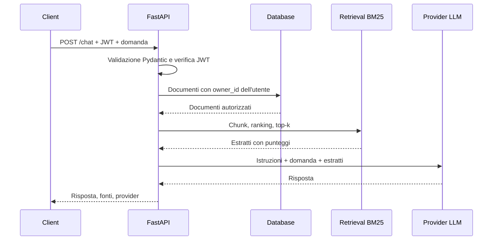

# Guida di studio: dal protocollo HTTP al Transformer

## 1. Il flusso completo

Il progetto usa un monolite modulare. Puoi seguire una richiesta senza attraversare
microservizi. `create_app` rende configurazione e provider sostituibili nei test;
`lifespan` possiede le risorse con durata pari a quella dell'applicazione.
Le rotte sono raggruppate per funzionalità in `app/api/`: ogni endpoint ha il
suo file e ogni funzionalità un `routes.py` che collega percorsi e handler.
`application.py` contiene la factory, `lifespan.py` gestisce le risorse,
`dependencies.py` le dipendenze HTTP e `middleware.py` l'osservabilità. Il registro
centrale è `app/api/routes.py`.

Il contratto `LLM` usa structural typing: una classe soddisfa il protocollo se
espone i metodi previsti, senza ereditare obbligatoriamente da una classe base.

## 2. HTTP, FastAPI e Pydantic

Leggi `schemas.py`: un DTO decide quali dati accettare o esporre. Il modello ORM
serve invece a rappresentare i dati persistenti. Restituire l'utente ORM senza un
contratto dedicato rischierebbe di esporre `password_hash`.

`Annotated` collega un tipo alle informazioni per la dependency injection.
FastAPI risolve `CurrentUser`, che usa la sessione DB e la credenziale Bearer.
La dipendenza con `yield` chiude la sessione anche quando la richiesta fallisce.
La cache delle dipendenze riusa la stessa sessione dentro una richiesta.

Studia i codici restituiti: 201 per creazione, 204 per cancellazione, 401 per
credenziale assente o invalida, 404 anche quando un documento appartiene a un
altro utente, 409 per conflitto, 422 per input invalido, 502/504 per provider.
La risposta 404 evita di confermare l'esistenza di risorse altrui.

Esercizio: aggiungi un PATCH con campi opzionali e `model_dump(exclude_unset=True)`.
Distingui campo assente da `null` esplicito; mantieni il controllo ownership.

## 3. Database, transazioni e migrazioni

Una `AsyncSession` è un'unità di lavoro, non una connessione globale da condividere
tra task concorrenti. Le query usano espressioni SQLAlchemy e parametri; non
costruiscono SQL concatenando l'input. Dopo un IntegrityError si esegue rollback:
la sessione non può continuare una transazione fallita.

L'indice `owner_id` aiuta le query multitenant. La paginazione offset è semplice,
ma diventa costosa con offset grandi; inoltre inserimenti concorrenti possono
spostare i risultati. Per dataset estesi usa un cursore su `(created_at, id)`.

`create_all` crea tabelle mancanti; non evolve quelle esistenti. Alembic registra
revisioni, consente review del DDL e permette deployment ripetibili. Non eseguire
migrazioni concorrenti da ogni replica in produzione: usa un job di rilascio.

Esercizi: aggiungi tag e relazione molti-a-molti, testa rollback e unicità,
esamina un EXPLAIN su PostgreSQL. Evita N+1 con caricamento esplicito delle relazioni.
Il controllo "100 documenti" attuale è didattico: due inserimenti concorrenti
possono superarlo; una quota rigorosa richiede lock o aggiornamenti atomici.

## 4. Sicurezza applicata

Argon2 salva hash con salt; non cifra password recuperabili. La verifica costosa
viene eseguita in thread per non bloccare l'event loop. JWT è firmato, non cifrato:
non contiene password o informazioni riservate. L'algoritmo è fissato dal server,
e si controllano scadenza, issuer, audience e presenza dei claim.

CORS è una policy del browser, non un controllo di autorizzazione. Ogni endpoint
documentale filtra per proprietario sul server, incluso il retrieval. I token
scadono ma non hanno revoca o refresh: per quello servono una strategia di sessione
e rotazione dei token. Registrazione e login non hanno rate limiting integrato:
prima di esporli pubblicamente aggiungilo al gateway o con Redis condiviso.
Limita anche corpo HTTP, numero di connessioni e concorrenza al proxy.

`SecretStr` riduce esposizioni accidentali nella rappresentazione della config;
non è un secret manager. In produzione usa HTTPS, secret gestiti, backup,
rotazione delle chiavi e policy per retention. `/metrics` va su rete interna.
Gli errori 502 non restituiscono dettagli del provider; controlla comunque che il
sistema di raccolta dei log non conservi eccezioni con dati sensibili.

## 5. Async, CPU, GPU e backpressure

`async` permette di cedere il controllo durante I/O. Non rende veloce un ciclo
CPU o un kernel GPU. Il client OpenAI e il DB sono asincroni; hashing, retrieval
e inferenza locale vengono spostati in thread. Il retrieval Python resta
soggetto al GIL: `to_thread` non equivale a parallelismo CPU su più core.

Un semaforo limita generazioni simultanee per processo. Non è una coda durevole,
né un limite globale tra worker, né un rate limiter per utente. Il timeout include
l'attesa del semaforo. La cancellazione del task non interrompe il lavoro già
partito in un thread; l'inferenza locale mantiene il lock fino al termine.
Per carichi reali usa un servizio di inferenza dedicato e una coda con ammissione
limitata. Evita di avviare decine di worker ognuno con un modello GPU.

SSE usa messaggi con `event:` e `data:` separati da una riga vuota. Qui si genera
prima tutta la risposta, poi la si divide in delta: gli errori mantengono il codice
HTTP corretto, ma il tempo al primo token non migliora. Per streaming nativo devi
consumare gli eventi del provider e definire errori e cancellazione dopo gli header.
Per POST con Bearer, sul browser usa `fetch` e uno stream reader; EventSource non
supporta direttamente quel metodo e quegli header.

## 6. RAG e valutazione

Retrieval-Augmented Generation: recupero estratti dal corpus autorizzato e li
fornisco al generatore. Non addestro il modello e non modifico i suoi pesi.
I chunk sono di 1000 caratteri con passo 800: overlap 200. BM25 pesa frequenza
dei termini, rarità nel corpus e lunghezza del chunk. La baseline funziona bene
su parole condivise ma non riconosce automaticamente sinonimi o parafrasi.
L'intero corpus dell'utente viene letto a ogni domanda: è un limite consapevole.

Un'evoluzione utile è usare embeddings con pgvector: salva embedding e versione
del modello in fase di ingestione, confronta cosine similarity con indici ANN,
combina ricerca lessicale e vettoriale con reciprocal rank fusion, poi usa un
reranker sui candidati. Filtra SEMPRE per utente prima di consegnare contesto
al generatore, anche quando usi un vector store esterno.

Istruzioni e delimitatori aiutano contro prompt injection nei documenti, ma non
sono una barriera garantita. Il modello non ha tool con effetti esterni in questo
progetto. Le fonti della risposta sono estratti recuperati: le citazioni generate
non vengono verificate automaticamente. Non confondere presenza di `[1]` con
veridicità dell'affermazione. Non c'è memoria conversazionale: ogni domanda è autonoma.

Per valutare davvero, prepara un dataset con domanda, documenti attesi, risposta
attesa e casi senza risposta. Misura recall@k/MRR del retrieval, correttezza delle
citazioni e grounding, astensione, latenza p50/p95 e costo/token. Versiona corpus,
prompt e modello. I test offline verificano il software, non la qualità del modello.

Esercizio: costruisci 20 casi in italiano con sinonimi, negazioni, fonti in conflitto,
documenti malevoli e domande di altri utenti. Confronta BM25 e ricerca ibrida con
lo stesso dataset e analizza gli errori, senza cambiare insieme tutte le variabili.

## 7. Osservabilità e qualità

Request ID collega la risposta ai log. Le metriche usano il template della rotta,
non URL con ID utente: evita cardinalità illimitata e dati personali nelle label.
La latenza middleware misura fino agli header, non l'intero consumo SSE. Aggiungi
metriche distinte per retrieval, generazione, coda e token se vuoi analizzarli.
Non registrare prompt e contenuti per default.

I test creano DB temporanei: non cancellano dati personali. Coprono isolamento tra
utenti, credenziali, validazione, ranking, cancellazione, SSE e guasti del provider.
Manca ancora una prova d'integrazione contro un PostgreSQL vero e un test end-to-end
con ciascun modello reale. SQLite non riproduce tutti i lock o i tipi di PostgreSQL.
Docker e CI sono forniti come configurazioni da eseguire nel proprio ambiente.

Mypy controlla i moduli applicativi e segue l'adapter locale; il laboratorio torch
ha typing più leggero. Ruff formatta anche quel codice. La coverage misura quali
righe sono eseguite, non la bontà delle asserzioni.

## 8. Il Transformer da zero

In `custom_llm` segui tokenizzazione a caratteri → embedding dei token e delle
posizioni → blocchi con attention causale → feed-forward → logits sul vocabolario.
La mask triangolare impedisce di leggere token futuri durante il training.
Il softmax converte logits in probabilità; cross-entropy confronta le predizioni
con il token successivo. Residual e LayerNorm aiutano il gradiente attraverso i layer.

`train()` abilita dropout, `eval()` lo disabilita; `no_grad()` evita di costruire
il grafo dei gradienti. Sono controlli diversi. AdamW aggiorna i parametri; il
clipping limita esplosioni del gradiente. Il validation split non addestra i pesi.
Il nome storico `BiagramLanguageModel` è mantenuto per compatibilità, anche se
l'architettura attuale contiene più blocchi Transformer.

Esercizi: conta i parametri, misura la memoria con diverse lunghezze di contesto,
aggiungi temperature/top-k al sampling, confronta attention manuale con
`scaled_dot_product_attention`, implementa un checkpoint riprendibile con stato
optimizer, RNG e step. Non caricare checkpoint pickle da fonti non attendibili.

## 9. Estensioni da implementare dopo aver capito la base

- Estendi i [task Celery già implementati](TASKS.md) all'ingestione, con outbox, idempotenza e dead letter queue.
- Cache Redis con chiave che includa utente, corpus/versione, prompt e modello; invalidazione su modifica.
- Outbox transazionale quando un commit DB deve produrre un evento affidabile.
- Embeddings pgvector e benchmark di ricerca ibrida; estrazione PDF con limiti di risorse.
- Output strutturati con schema Pydantic e test per refusal, output incompleto e input ostile.
- Tool calling con allowlist, validazione degli argomenti e autorizzazione prima di effetti esterni.
- OpenTelemetry per tracing distribuito; dashboard Prometheus e test di carico con Locust.
- Integrazione OIDC con un identity provider quando servono login federato e revoca.

Queste sono estensioni, non funzionalità già implementate. Aggiungile con una
misura o un requisito concreto, mantenendo visibile il flusso dei dati.

Il flusso Celery esistente è spiegato in [TASKS.md](TASKS.md), inclusi i limiti di
consegna, retry e cancellazione.

## 10. Domande da colloquio

1. Perché una chiamata torch dentro `async def` può bloccare il server?
2. Come eviti che un documento di un altro utente finisca nel prompt?
3. Che differenza c'è tra autenticazione, autorizzazione e CORS?
4. Perché `create_all` non sostituisce Alembic?
5. Quando scegliere retrieval, fine-tuning o entrambi?
6. Perché un retry su una richiesta non idempotente può duplicare effetti?
7. Cosa succede se il provider fallisce dopo aver iniziato uno stream?
8. Come dimostri che una modifica al chunking migliora le risposte?
9. Come gestisci quote tra più worker e più repliche?
10. Quali dati finiscono presso il provider e quali nei log?

## Riferimenti ufficiali

- [FastAPI: dependency injection](https://fastapi.tiangolo.com/tutorial/dependencies/)
- [FastAPI: settings](https://fastapi.tiangolo.com/advanced/settings/)
- [Pydantic: modelli](https://docs.pydantic.dev/latest/concepts/models/)
- [SQLAlchemy: asyncio e sessioni](https://docs.sqlalchemy.org/en/20/orm/extensions/asyncio.html)
- [Alembic: tutorial](https://alembic.sqlalchemy.org/en/latest/tutorial.html)
- [OpenAI: SDK Python e client asincrono](https://developers.openai.com/api/reference/python)
- [PyTorch: Transformer e attention](https://docs.pytorch.org/docs/stable/generated/torch.nn.functional.scaled_dot_product_attention.html)
