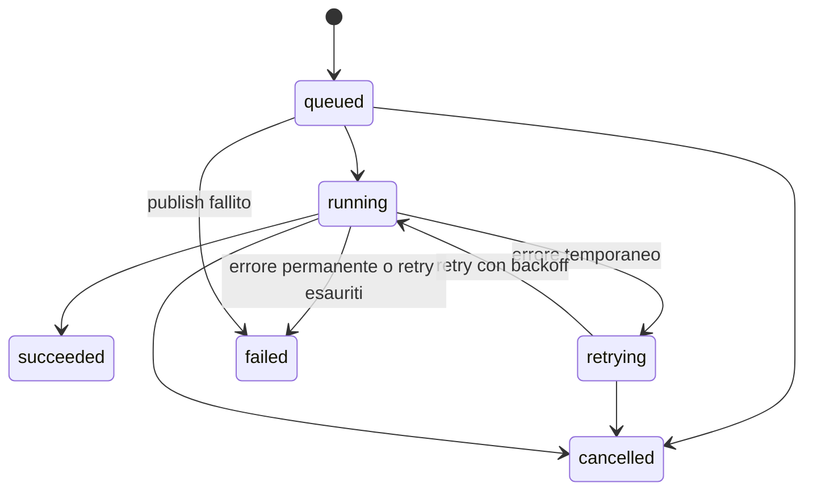

# Task asincroni con Celery e Redis

## Un flusso da provare

`POST /api/v1/chat` aspetta una risposta. `POST /api/v1/tasks` invece registra il
lavoro, lo pubblica al broker e restituisce **202 Accepted**, un ID e l'header
`Location`. Un worker separato esegue retrieval e generazione; il client legge
stato e risultato con polling. La richiesta HTTP non rimane aperta durante il lavoro.

| Endpoint | Comportamento |
| --- | --- |
| `POST /api/v1/tasks` | Accoda una domanda con lo stesso JSON di `/chat` |
| `GET /api/v1/tasks` | Lista paginata dei propri task, più recenti prima |
| `GET /api/v1/tasks/{id}` | Stato, tentativi, risultato o errore |
| `DELETE /api/v1/tasks/{id}` | Cancellazione logica; restituisce lo stato corrente |

Tutti gli endpoint richiedono il Bearer token. Un ID altrui o inesistente produce
404. La risposta non espone la domanda originale né credenziali; il risultato
contiene la stessa struttura `Answer` della chat sincrona.

## Avvio con Docker Compose

```bash
cp .env.example .env
# Imposta JWT_SECRET in .env
docker compose up --build
```

Compose avvia API, PostgreSQL, Redis e un worker Celery con due processi. L'API
applica le migrazioni; il worker aspetta la readiness dell'API. Redis usa AOF e un
volume persistente. Le porte di Redis e PostgreSQL non sono esposte all'host.

Da Swagger registra un utente, autorizzati, crea un documento, poi invia:

```json
{"question":"Come funziona Celery?","top_k":3,"max_output_tokens":256}
```

Copia l'ID e interroga `GET /api/v1/tasks/{id}`. Se non esistono fonti pertinenti,
il task completa senza chiamare il provider. Il worker usa i documenti presenti
al momento dell'esecuzione, non uno snapshot al momento dell'invio.

## Avvio locale separato

Avvia un Redis locale (ad esempio un container dedicato):

```bash
docker run --rm --name python-cv-redis -p 127.0.0.1:6379:6379 redis:7-alpine
```

Con lo stesso `.env` e dalla stessa directory, in due terminali:

```bash
uv sync --frozen
# Necessario anche su un DB già inizializzato prima dell'aggiunta dei task:
uv run alembic upgrade head
uv run uvicorn main:app --reload
```

```bash
uv run celery -A app.tasks:celery_app worker --loglevel=info --concurrency=2 -Q rag
```

Se il DB era stato creato con `create_all` e non ha ancora una versione Alembic,
verifica che corrisponda esattamente alla revisione 0001 e registra quella base
con `uv run alembic stamp 0001`, poi applica `upgrade head`. Non stampare `head`
perché salteresti la creazione della tabella `jobs`. Su un DB nuovo basta upgrade.

L'API continua a funzionare senza Redis per chat e documenti; l'invio dei task
restituisce 503 se il broker non è raggiungibile. Senza worker, i task rimangono
in `queued`. API e worker devono condividere DB, configurazione del provider e
broker. Con SQLite usa un percorso assoluto se avvii i processi da directory diverse;
per più worker e repliche preferisci PostgreSQL.

## Stati e transizioni



Il DB è la fonte di verità per stato e risultato. Nel broker passa solo l'ID;
il worker carica dal DB la domanda e l'owner. Non viene esposto `AsyncResult`, che
senza record applicativo non distingue bene task inesistente e lavoro in attesa.
`attempts` conta gli ingressi effettivi nel lavoro, non i retry futuri pianificati.

I moduli da leggere sono `queue.py` (configurazione/publish), `tasks.py` (worker),
`jobs.py` (aggiornamenti condizionali), `rag.py` (servizio condiviso) e le rotte in
`app/api/tasks/` (un file per endpoint), registrate in `app/api/tasks/routes.py`.
Il task Celery è sincrono e chiama `asyncio.run`: ogni esecuzione crea e
chiude engine DB e client LLM nel proprio event loop. Non condivide sessioni async
tra processi prefork. Il caricamento locale del modello avviene per task: è una
baseline semplice, per alto throughput serve un servizio di inferenza separato.

## Retry, consegna e cancellazione

Gli errori temporanei OpenAI di connessione, timeout, rate limit e server causano
fino a tre retry con attesa esponenziale e jitter (massimo quattro esecuzioni).
Gli altri errori terminano con un messaggio pubblico generico. I retry interni
dello SDK OpenAI possono aggiungersi a quelli Celery: considera costo e latenza.
Il timeout applicativo copre retrieval e generazione; non interrompe un thread
locale già in corso. Non è un hard time limit del processo Celery.

`acks_late` sposta l'ack dopo l'esecuzione e `worker_prefetch_multiplier=1` limita
la prenotazione dei messaggi. Non offrono exactly-once né un retry automatico per
ogni crash. Una riconsegna dopo un risultato terminale viene ignorata; riconsegne
concorrenti prima del completamento possono chiamare il provider più di una volta.
Il risultato persistente viene scritto solo se il job è ancora attivo. La
visibility timeout Redis è un'ora: mantienila maggiore della durata massima dei
lavori e dei retry. Un crash può lasciare `running` fino a riconsegna o recupero
operativo; alcuni tipi di terminazione vengono comunque confermati da Celery.

Cancellare imposta `cancelled` con un UPDATE condizionale. Il worker controlla lo
stato prima di partire; se è già partito può continuare a consumare risorse, ma
il suo risultato non sovrascrive la cancellazione. Non si usa `terminate=True`,
che interromperebbe un processo; la cancellazione non garantisce risparmio sui
costi della chiamata esterna. Un task già completato mantiene lo stato terminale.

Commit del record e publish Redis non sono atomici. Un crash tra i due può
lasciare `queued` senza messaggio; un errore ambiguo di publish può capitare dopo
che il messaggio è stato inviato. La risposta 503 non garantisce che il provider
non sia già partito. Questo progetto non implementa outbox o idempotency key per
le richieste POST. È il prossimo esercizio utile per renderlo più affidabile:
record job e outbox nella stessa transazione, dispatcher con retry e deduplicazione.

## Test e operatività

```bash
uv run pytest tests/test_tasks.py
# Test end-to-end opt-in con un Redis dedicato, mai uno condiviso con dati reali:
TEST_REDIS_URL=redis://localhost:6379/15 uv run pytest tests/test_celery_integration.py
```

I test ordinari simulano solo il publish: eseguono davvero worker logic e DB per
successo, riconsegna terminale, retry, failure, cancellazione prima e durante il
lavoro e isolamento. Il test opt-in avvia un processo Celery reale e usa Redis.

```bash
uv run celery -A app.tasks:celery_app inspect active
uv run celery -A app.tasks:celery_app inspect reserved
uv run celery -A app.tasks:celery_app inspect scheduled
```

Questi comandi ispezionano i worker, mentre l'API mostra lo storico applicativo.
Non abilitare serializer pickle o esporre Redis senza autenticazione/rete privata.
Non ci sono ancora retention automatica dei risultati, quota task, outbox,
scheduler periodico o dashboard Flower. La coda non sostituisce il rate limiting.

Riferimenti: [task e retry](https://docs.celeryq.dev/en/stable/userguide/tasks.html),
[configurazione](https://docs.celeryq.dev/en/stable/userguide/configuration.html),
[gestione dei worker](https://docs.celeryq.dev/en/stable/userguide/workers.html).
